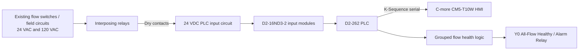

# Industrial Water Flow Monitoring Retrofit

A sanitized portfolio case study of a legacy industrial water-flow indication system migrated to a modern PLC/HMI architecture.

> **Portfolio note:** This repository intentionally excludes employer/site identifiers, production drawings, credentials, IP addresses, exact field wire numbers, and raw production backups. The files here show the engineering approach without publishing plant-specific implementation details.

## Project Summary

The project replaced an aging water-flow indication system with a new AutomationDirect controls platform while preserving the original field behavior and making the system easier to maintain.

The final design used:

- AutomationDirect DirectLOGIC **D2-262** CPU
- Three **D2-16ND3-2** 24 VDC digital input modules
- One **D2-08TR** relay output module reserved for expansion / alarm interfacing
- **C-more CM5-T10W** HMI
- Interposing relays to isolate existing **24 VAC and 120 VAC** field circuits from the new **24 VDC PLC inputs**
- **39 active flow inputs** total
- One consolidated healthy/alarm output derived from grouped flow conditions

## What Made the Project Interesting

The retrofit was not a simple one-for-one replacement. During drawing review and commissioning, nine apparent “new” inputs were discovered to already exist in the legacy system through interposing relay contacts. Those field circuits energized CR relays, whose contacts already drove existing PLC inputs.

Instead of duplicating those signals, the design was corrected before final commissioning:

- 22 original PLC inputs were retained
- 17 genuinely new points were added
- 9 addresses were deliberately left spare
- later addresses were kept unchanged so the PLC and HMI did not need unnecessary renumbering

That correction reduced wiring, simplified the program, and preserved the original signal chain.

## System Architecture



## PLC Design

The PLC was kept intentionally simple.

Each active physical input is mirrored into an internal status bit for troubleshooting and future expansion. The final alarm/healthy logic is grouped into five internal conditions so the ladder does not exceed DirectSOFT rung-length limitations.

```text
Group 1 healthy -> C100
Group 2 healthy -> C101
Group 3 healthy -> C102
Group 4 healthy -> C103
Group 5 healthy -> C104

C100 AND C101 AND C102 AND C103 AND C104 -> Y0
```

`Y0` is ON only when every active flow condition is healthy. Any failed flow input drops the healthy output.

See [docs/plc-design.md](docs/plc-design.md) for more detail.

## HMI Design

The C-more HMI was redesigned around the corrected 39-point database.

- 39 live flow indicators
- Red = no flow / abnormal
- Green = flow / normal
- 7 x 6 screen arrangement with 3 spare positions
- Direct PLC tags instead of maintaining duplicate “No Flow” tags
- K-Sequence communications to the D2-262

The HMI provides immediate visual identification of the failed circuit, while the PLC retains the real control/alarm function independently of the HMI.

## Engineering Decisions

A few design choices mattered more than the hardware itself:

- **Isolation first:** legacy AC signals never land directly on the new DC input cards.
- **Do not renumber just to make addresses pretty:** deliberate gaps were preserved after the duplicate-signal discovery.
- **PLC owns the alarm logic:** the system does not depend on the HMI for the main flow-health output.
- **Keep HMI logic simple:** one live flow tag per point; display behavior handles red/green indication.
- **Document what changed and why:** the corrected legacy signal path became part of the turnover documentation.

## Validation / Commissioning

The commissioning plan included:

- verifying field voltage before transferring conductors
- labeling original conductors before removal
- point-to-point verification of each PLC input
- confirming intentional spare addresses remained unused
- online PLC status testing
- HMI tag verification against the PLC database
- validation of the grouped all-flow healthy output

## Skills Demonstrated

Industrial controls troubleshooting, legacy drawing interpretation, PLC migration, DirectLOGIC / DirectSOFT programming, digital I/O design, relay isolation, octal addressing, HMI development, C-more tag database design, serial communications, commissioning, and technical documentation.

## Repository Contents

- `README.md` — portfolio overview
- `docs/legacy-vs-new.md` — old system vs. retrofit architecture
- `docs/plc-design.md` — PLC I/O and alarm design notes
- `docs/hmi-design.md` — HMI layout and communication notes
- `docs/commissioning.md` — commissioning approach
- `examples/alarm_logic_example.txt` — sanitized representative DirectSOFT mnemonic logic
- `examples/cmore_tags_example.csv` — sanitized representative C-more tag import structure

## Disclaimer

This is a sanitized engineering portfolio project. It is not a production backup and is not intended to be loaded into an operating machine. Site-specific drawings, exact conductor numbers, plant network details, and proprietary production files are intentionally excluded.
