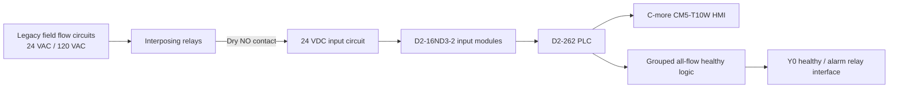

# Legacy vs. Retrofit Architecture

## Legacy system

The original water-flow indication system mixed existing field circuits with relay logic and a legacy PLC/HMI arrangement. Some flow circuits were 24 VAC and others were 120 VAC. Several signals were already conditioned through interposing relays before reaching the PLC.

The main challenge was not simply replacing hardware. The drawings had to be reconciled against the actual signal chain so the retrofit would preserve existing behavior without duplicating signals.

A key discovery was that nine apparent "new" field circuits already drove existing PLC inputs through CR relay contacts. Treating those circuits as new points would have duplicated the same process information and created unnecessary wiring and logic.

## Retrofit architecture

The corrected design kept the existing field behavior but standardized the PLC side on 24 VDC discrete inputs.

## Result

The final I/O model used 39 active flow inputs:

- 22 original PLC inputs retained
- 17 genuinely new inputs added
- 9 addresses intentionally left spare after the duplicate-signal discovery
- later addresses preserved to avoid needless renumbering

The retrofit improved maintainability while keeping the control philosophy simple and understandable for future technicians.
